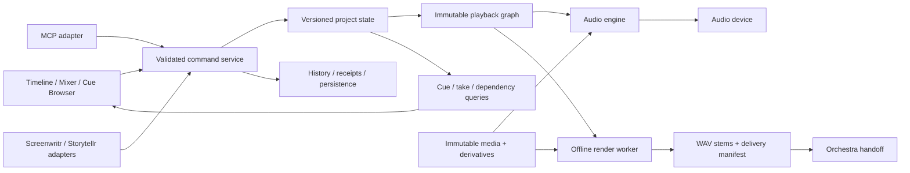

# Soundr architecture

> Historical M0/v0.1 design. Current M1 behavior is documented in [RUNTIME.md](RUNTIME.md), [MCP.md](MCP.md) and [MILESTONE_1.md](MILESTONE_1.md). The original example/schema is not a runtime v2 project.

Status: proposed Soundr design. Research sources establish patterns, not an implemented Soundr system. Architecture decisions appear in [docs/decisions](decisions/ADR-001-project-model-and-commands.md).

## Module boundaries

| Module | Owns | Must not own |
|---|---|---|
| Project core | IDs, entities, edit semantics, invariants and revision history | GUI widgets, device callbacks |
| Command service | Validation, atomic mutations, idempotency and result receipts | Arbitrary shell/file/code execution |
| Media service | Source metadata, hashing, relinking, copies and derivative lineage | Destructive rewriting of originals |
| Audio engine | Playback graph evaluation, device transport and timing counters | Project-file writes or AI calls in its audio callback |
| Picture service | Proxy decoding, frame/time mapping and sync observations | Owning the audio clock |
| Render worker | Frozen render request, dependency verification and output receipts | Reading moving UI state midway through a job |
| UI | Selection, editing gestures, cue/mixer display and previews | Directly changing canonical project objects |
| MCP/sibling adapters | Typed request/response translation and scoped access | A second editing implementation |

The source study supports separating engine, source/arrangement and UI responsibilities; Soundr's detailed contracts are original proposals. [Ardour study](../research/ardour.md)

## State, processing and time

The project is structured data. UI selection, waveform tiles and decoded caches are projections; losing a cache must not change the mix. Source files are immutable dependencies. Derivatives carry parent identity and processing provenance.

Use a monotonic integer revision for editing state. A successful mutation changes state and records its request/result identity atomically. Undo creates a new revision and preserves history. A drag gesture previews transient movement and commits a bounded edit, rather than persisting every pointer event.

The audio engine consumes a validated immutable graph at a processing boundary. A worker prepares routing, allocations, source readers and effect state outside the callback. The callback performs bounded processing; it does not hash files, decode picture, save projects, run scripts or call a model. Meter/transport notifications use bounded queues. Underruns, graph changes and device failures are observable.

Audio-device sample position is the playback clock. The picture viewer follows it using the picture's exact frame-rate fraction, timeline offset and calibrated monitoring offset. Store canonical frame values and sample values in their own domains. Convert once at a boundary; do not repeatedly round back and forth. Native desktop evidence and independently inspected renders must verify sync.

## Persistence decision boundary

The JSON schema specifies the logical project document, not a durability guarantee or database choice. The implementation must choose and prove either transactional storage or atomic checkpointing with a bounded durable history/idempotency mechanism. Project state, revision and command receipts cannot be committed independently. Exporting a JSON snapshot must not export credentials or disposable caches.

The storage spike tests interrupted saves, disk-full/error returns, truncated records, restart, old-schema migration, concurrent stale requests and restore from a last-known-good snapshot on the actual Windows filesystem. Migration preserves the original file and emits a conversion receipt. No autosave failure may be reported as a successful explicit save.

## Ownership and sibling integration

Soundr owns sound arrangements, takes, mix graphs and render jobs. Screenwritr remains the source for script/character identities and text revisions; Storytellr remains the source for shots/events/edit revisions. Soundr stores namespaced external references and the imported revision. It must not overwrite sibling content as a side effect of editing audio.

Orchestra remains the production/control plane and receives artifacts plus manifests through an explicit adapter. Orbit's build ownership is not duplicated inside Soundr. The current Orchestra README confirms these roles; current Screenwritr/Storytellr package metadata confirms local application/MCP entry points, but their entity APIs were not audited in this pass. Every adapter in this diagram is therefore proposed, not working.

## Trust boundaries for the first implementation

| Boundary / asset | Concrete failure to prevent | Proposed control |
|---|---|---|
| MCP command -> project | Stale/duplicate changes move clips twice | Schema validation, expected revision and persisted idempotency |
| Media path -> filesystem | Traversal, junction escape, replacing originals | Resolve canonical paths against approved roots; identity/hash checks; no arbitrary delete operation |
| Media file -> decoder | Malformed input exhausts memory or crashes editor | Bounded metadata/size limits; isolated cancellable decode workers |
| Script/text/story adapter -> UI | Content is interpreted as code or instructions | Treat as data, escape display output, validate namespaced references |
| Render request -> output folder | Colliding or escaping output overwrites other work | Approved destination handle, safe relative filenames, create-new default, atomic completion |
| Audio callback -> workers/UI | Slow work causes dropouts | Bounded queues, preallocated graph, underrun diagnostics |

Start MCP through a user-launched local stdio process. If a network transport is later added, it needs a separate authentication/authorization design; loopback alone is not an access-control scheme. There is no network listener in this research pack.
